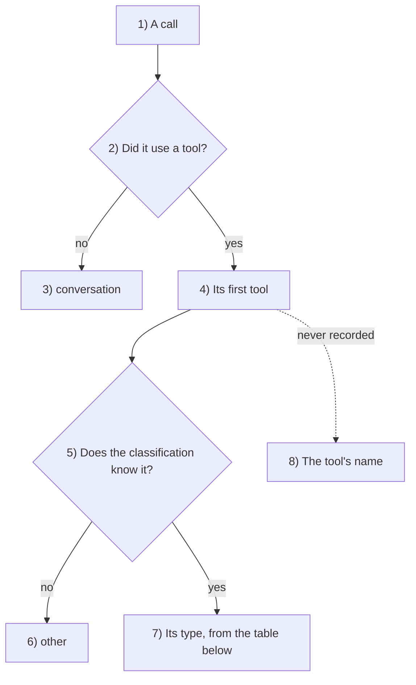

# Activity types

Each recorded call carries one label for the kind of work it did, so that the report can split the cost by activity.

**Status:** designed, not built yet.

**Spec:** `activity-types`

**Requirements:** R6

## Expected behaviour

How a call gets its activity type:

- 1) A model call that capture records (R2).
- 2) Whether the call used any tool (R6).
- 3) A call with no tool is `conversation` (R6).
- 4) Otherwise its first tool chooses the label (R6).
- 5) Whether the classification knows that tool (R6).
- 6) A tool that it does not know is `other` (R6).
- 7) A tool that it knows gives its type, as the table below gives it (R6).
- 8) The tool's name is read only to choose the label, and never recorded (R4, R6).

In detail:

The label comes from the first tool the call used, as R6 gives it:

| The call's first tool | Activity type |
|---|---|
| A file edit or write | code generation |
| A read or a search | file reading |
| A shell command | tooling |
| An MCP tool (`mcp__...`) | MCP |
| Starting a subagent | subagent |
| A tool the classification does not know | other |
| No tool at all | conversation |

The name of the call's first tool is read only to choose the label. It is never recorded, as R6 gives it, because an MCP server's name can name a private service.

## Not covered

- Code review as an activity type of its own. Tool names alone cannot tell a review apart from other work, so a review's calls are recorded like any others, each under the type of the first tool that it used, as in the table above.

## How it is validated

This feature is validated first by its spec's scenarios: each gets an acceptance test before its code, seen to fail for the expected reason (task 1.4). Then come the checks that DR-084 to DR-093 and DR-109 apply to all the tool's code. Beyond those, this feature has its own:

- Synthetic transcripts with each kind of tool call, an MCP call among them, and a call whose tools are of several types (task 1.1), and the tests of the classification itself (task 2.5).

## Known limitations and the roadmap

No risk of the design concerns this feature alone.

The [roadmap](../roadmap.md) gives what is planned next and later, and the limitations that an adopter notices.

## See also

- `activity-types` in `openspec/`, and design decision 5 of `add-pr-cost-calculator`.
