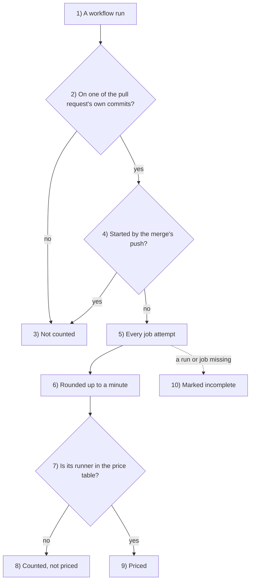

# CI minutes

The report adds what the pull request's GitHub Actions runs cost, from the times GitHub gives for each job.

**Status:** designed, not built yet.

**Spec:** `ci-minutes`

**Requirements:** R18, R62, R120, R121, R63, R64

## Expected behaviour

Which CI minutes count:

- 1) A workflow run that the report finds, with the fewest calls it can (R121).
- 2) Only runs on the pull request's own commits count (R62).
- 3) Runs on other commits are not counted (R120).
- 4) Runs that the merge's push starts are not counted (R120).
- 5) Every job attempt of the pull request's own runs counts (R62).
- 6) Each attempt's minutes are rounded up and priced per job (R18).
- 7) Whether the price table lists the attempt's runner (R63).
- 8) Minutes on a runner that it does not list are counted, not priced (R63).
- 9) The others are priced at the table's rate (R18).
- 10) A CI cost missing any run or job is marked incomplete, and not presented as the total (R64).

In detail:

- **Which runs.** R62 gives which job attempts count, and which commits are the pull request's own.
- **Which runs are not counted.** Those that R120 gives, and runs on commits that a force-push removed.
- **Rounding.** R18 gives how each attempt's minutes are rounded and priced.
- **Unknown runners.** R63 gives how minutes on a runner that the price table does not list are counted and reported.
- **Incomplete.** R64 gives when the CI cost is marked incomplete and not presented as the total.

## Not covered

- A pull request based on another that was merged by squashing or rebasing counts that one's runs again unless it is rebased first.
- Included minutes and plan discounts: the figure is at GitHub's list rate.

## How it is validated

This feature is validated first by its spec's scenarios: each gets an acceptance test before its code, seen to fail for the expected reason (task 1.4). Then come the checks that DR-084 to DR-093 and DR-109 apply to all the tool's code. Beyond those, this feature has its own:

- Tests against recorded API responses for a merge commit, a squash, a rebase merge and a fast-forward, a run on the pull request's `closed` event, and a pull request with more commits than the call budget allows (task 3.3).

## Known limitations and the roadmap

The design's risks that concern this feature and are not on the roadmap, each with what it means:

- **A force-push removes commits that CI ran on**: the removed commits' runs are not counted.
- **A pull request's commits and runs use up the report's call budget, or the requests per hour that `GITHUB_TOKEN` can make in the repository**: the comment marks the CI cost as incomplete, or no comment is posted and the job summary says why.

The [roadmap](../roadmap.md) gives what is planned next and later, and the limitations that an adopter notices.

## See also

- `ci-minutes` in `openspec/`, and design decision 7 of `add-pr-cost-calculator`.
