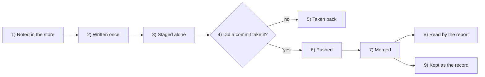

# The ledger

The ledger is a set of small files under `.pr-cost/ledger/` that the agent's commits add. It carries the counts to the pull request, and after the merge it stays on the default branch as the pull request's record, so that every reported cost can be recomputed.

**Status:** designed, not built yet.

**Spec:** `ledger`

**Requirements:** R4, R156, R163, R77, R10, R56, R57, R22, R58, R59, R119, R60, R290, R306

## Expected behaviour

The life of a ledger file:

- 1) A ledger file is noted in the store before it is written (R57).
- 2) It is written once, with a first line that states its format's version (R10, R156).
- 3) The capture step stages only the ledger file that it wrote (R56).
- 4) A ledger file that a commit takes stays taken (R52).
- 5) One that no commit takes is taken back, and its calls wait for a later commit (R9, R113).
- 6) The push of the commit publishes it, and an opt-out later leaves it to git (R146).
- 7) The merge adds it to the default branch (R58).
- 8) The report counts only the ledger files that the merge adds, each call at most once (R58, R59).
- 9) The ledger stays in the repository as the record (R22).

In detail:

- **One file per commit,** named `.pr-cost/ledger/<YYYY-MM>/<random>.jsonl`, one line per call after a first line that states the file's format, and written once, as R10 gives it.
- **The first line.** It states the version and the release that R156 gives, so that the report can say when a file of any version comes from a later release than its own (DR-208), the number of calls that capture refused, and one flag for each reason that capture left calls out: for consent, for their age, or because their repository could not be told, as R155 gives them. Each entry after it marks the calls that R42 and R43 count.
- **Day, agent and provider.** Each entry names its UTC day, its agent and its provider, so that a later agent or provider needs no new format (R290, R77). No field records how a call was paid (DR-302).
- **Counts, never content.** A line holds no prompt, response, code, file contents, tool name, tool input or output, path, working directory, branch name, user name, session identifier, transcript path, `tool_use_id` or time of day, nor a hash of any of them. The model's name, the price attributes and the provider are the only text taken from a transcript, and each is recorded only when the price table lists it, or else as `unknown` (R4, R77, R290).
- **A published format.** Each version of the format is published in `docs/ledger-format.md` with a JSON Schema for each kind of line, as R156 gives it, so that anyone can check a ledger file without the tool, and what no schema can hold, such as a field given twice, is listed beside it, where the report's rules decide. R163 gives the one id by which every version names a call.
- **The record.** The ledger stays in the repository after the merge, and the report writes nothing to the repository (R22).
- **Counted once.** R58, R59 and R119 give which ledger files and entries the report counts, and which it flags or counts as restored.
- **Visible in review.** A pull request's ledger files are in its diff like any other file. Removing a ledger file before the merge removes its calls from the cost.
- **What stays published.** A ledger file that was pushed stays in its branch's history, in every clone and fork that holds it, and in the report comments already posted, whatever its author does later: an opt-out, a removed ledger file or a removed store changes none of them. A ledger file in a commit not yet pushed is published by that commit's push, opt-out or not, and a force-push that drops a commit does not remove what GitHub keeps for the pull requests that referenced it.
- **What a hash does not hide.** An entry names its call by a hash of the call's message id, and that does not hide whose record it is: the commit that adds the ledger file names its author, and where a cloud session commits under Claude Code's own name, the pushes and the pull request that carry it are the person's, and whoever holds the transcript can match each hash to its call.

## How it is validated

This feature is validated first by its spec's scenarios: each gets an acceptance test before its code, seen to fail for the expected reason (task 1.4). Then come the checks that DR-084 to DR-093 and DR-109 apply to all the tool's code. Beyond those, this feature has its own:

- The format is written down first, and the tests read its values from that document (task 1.2).
- Each version's schema checked with a standard JSON Schema validator and its default options, refusing each line that the report refuses, but for what no schema can hold, and accepting each line that it counts, with a property-based test that finds no line that the schema and the report's reader judge apart (task 1.2), and the surface manifest holding each released version's schema by its hash, so that a change to one fails the checks (task 6.1).
- Property tests that no planted string reaches a ledger file's contents or its path (task 2.1), and a check that a ledger file raises no finding from a common secret scanner (task 1.2).
- Unit tests at every boundary of the format on the report's side (task 4.2), and one fixture for each released format (task 6.4).

## Known limitations and the roadmap

The design's risks that concern this feature and are not on the roadmap, each with what it means:

- **A ledger edited by hand changes the reported cost**: the reported cost changes with the edit, which shows in the pull request's diff.
- **Capture and the report read the call ids of every ledger file that their branch holds, and the report those of every ledger file that the default branch's first-parent history held before the merge, which grow with every pull request, and which whoever merged them wrote, while capture's store grows with every call it records until its retention window drops it**: the report counts none of a pull request's entries once its ledger files together pass the size bound that the ledger format documents, and its comment says they are too large to read.
- **The published schema and the report disagree about a line**: where the format says that a schema cannot hold a rule, the report's rule decides.

The [roadmap](../roadmap.md) gives what is planned next and later, and the limitations that an adopter notices.

## See also

- `ledger` in `openspec/`, and design decisions 3 and 16 of `add-pr-cost-calculator`.
- `docs/ledger-format.md`, which task 1.2 writes, for the exact format.
