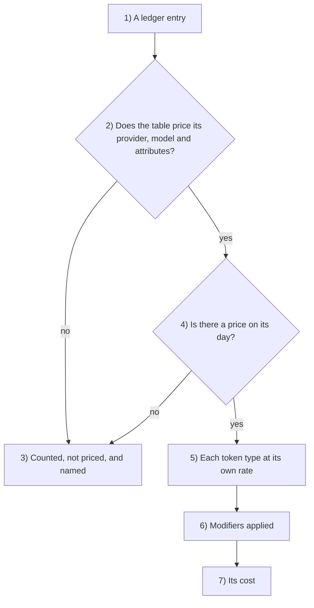

# Pricing

The tokens are priced from a dated price table kept in this repository, at the price that applied on the day each call was made.

**Status:** designed, not built yet.

**Spec:** `pricing`

**Requirements:** R14, R15, R16, R61, R17, R287, R288, R289

## Expected behaviour

How a call is priced:

- 1) An entry of a ledger file that the report counts (R58).
- 2) Whether the price table has a row for the entry's provider and model (R289), lists each attribute that changes its price, and prices their combination (R17, R61).
- 3) An unknown provider, model, attribute or combination, or a model that the table lists without a price, is counted in tokens, left out of the cost and named (R17, R61, R287, R289).
- 4) The latest price whose effective date is on or before the entry's UTC day, and an entry whose day has no price yet is left out and named (R14).
- 5) Each token type is priced at its own rate (R15).
- 6) The modifiers that the price table states apply (R16).
- 7) The entry's cost, from the table at the tool's own commit, never fetched (R30).

In detail:

- **Dated prices.** R14 gives how each price, and each statement of how modifiers combine, is dated, and which one a call uses. A price change is a new row with a later date, so history is never rewritten (DR-020).
- **Each token type at its own rate.** R15 gives the rate of each token type, and the range that a cache write of unknown lifetime gets.
- **Modifiers.** R16 gives the modifiers that apply, as the price table states them.
- **Nothing is guessed.** A model, attribute or combination that the price table does not price is counted in tokens, left out of the cost and named by the report, as R17 and R61 give it.
- **One currency.** The price table states the one currency of all its prices, and every cost is written in it, by its code (R288).
- **Providers.** Each row names the provider that sells the model's use, and a call is priced by its own provider's row (R289).
- **Models with no price.** The table can list a model with no price, such as a self-hosted one, whose tokens are counted under its name (R287).
- **Never fetched.** Prices are read from the table at the tool's own commit. The tool fetches no prices from anywhere, as R30 gives it for the whole tool.

## How it is validated

This feature is validated first by its spec's scenarios: each gets an acceptance test before its code, seen to fail for the expected reason (task 1.4). Then come the checks that DR-084 to DR-093 and DR-109 apply to all the tool's code. Beyond those, this feature has its own:

- A test that every price row has its date and its source, and that a pull request cannot change or remove an existing row or add one dated on or before the newest existing one for the same price (task 3.1).
- Tests of each modifier and of their combinations, with property tests that a cost is never negative and adds up across any split of the ledger (task 3.2).

## Known limitations and the roadmap

The design's risks that concern this feature and are not on the roadmap, each with what it means:

- **An adopter updates the hook and the workflow pin at different times**: something goes unpriced, and the comment says so instead of guessing.
- **Cache writes recorded without their lifetime**: the report gives a range for those cache writes.
- **Prices go stale, or a new model appears**: a model that the price table does not list is named rather than priced until the table is updated.

The [roadmap](../roadmap.md) gives what is planned next and later, and the limitations that an adopter notices.

## See also

- `pricing` in `openspec/`, and design decision 4 of `add-pr-cost-calculator`.
