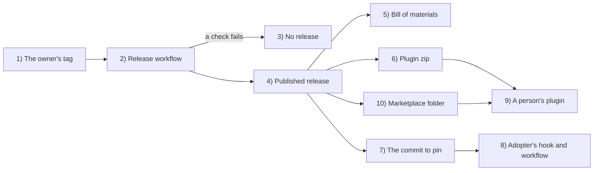

# Releases and compatibility

The tool is meant to be used inside other projects, so it keeps to old enough Python versions for adopters to keep up, and it is released in versions whose numbers say what changed.

**Status:** the supported versions and the update rules are in place; the capture step's floors and releases are designed, not built yet.

**Spec:** `releases-and-compatibility`

**Requirements:** R25, R99, R26, R27, R230, R71, R122, R123, R28, R72, R183, R188, R189, R184, R190, R32, R251, R259, R262, R260, R261, R263

## Expected behaviour

From a tag to what an adopter pins:

- 1) A tag `vMAJOR.MINOR.PATCH`, for a commit in the default branch's first-parent history, whose numbers say what an adopter must do (R27, R71).
- 2) The release workflow checks the tag, the tests, the guide, the risks and the public surface (R27, R123, R230, R251).
- 3) A tag that it refuses names no release (R27).
- 4) A release is published only once its files are attached and checked (R189).
- 5) Every release carries a CycloneDX software bill of materials (R28, R72).
- 6) Each release carries the plugin as a zip that its tag rebuilds, whose SHA-256 the README gives (R183).
- 7) The release's text names the commit to pin (R27).
- 8) An adopter takes the hook file, its registration and the calling workflow from the README at that commit (R203).
- 9) A person adds the plugin from the zip, or from the marketplace (R187).
- 10) The marketplace serves only a release's plugin (R184, R190).

In detail:

- **Python.** The tool runs on Python 3.11 and every later release, with the standard library only. R25 and R99 give how CI tests it and where the oldest version is kept. The oldest rises only when its version nears its end of life, or when a security fix needs a newer one, on the owner's decision (R26).
- **Floors of the capture step.** Under a Python older than 3.11, or a git older than 2.43, the capture step records nothing, stages nothing, prints nothing and exits with success (R32), so an old machine is never blocked from committing.
- **Dependency updates.** Minor and patch updates and vulnerability fixes are proposed as usual. A major update waits for the owner's approval on Renovate's dependency dashboard (R26). A daily check in this repository warns the owner when Renovate seems to have stopped proposing them (R263, DR-267).
- **Versions.** Semantic: the major number rises for a change that adopters must act on, which is any change to the public surface that R122 lists and keeps in a manifest, and R71 and R123 give how a release whose manifest changed is numbered; the minor number for new behaviour; the patch number for a fix.
- **Releases.** A release is made by pushing a tag `vMAJOR.MINOR.PATCH` for a commit in the default branch's first-parent history. R27, R190, R230 and R251 give the tags that the release workflow refuses, and R189 how it attaches and checks the release's files before it publishes the release, which names the commit to pin (DR-209). A tag that the workflow refused names no release, and its version is not used again.
- **Bill of materials.** Every release carries a CycloneDX JSON software bill of materials, as R28 gives it, and R72 gives when a release is not published for it.
- **The plugin's zip.** Each release carries the plugin as a zip that R183 gives, whose SHA-256 the README gives, so a person can check a zip against the README at the release's commit before they upload it (DR-203).
- **What the plugin declares.** R188 gives what each commit builds the plugin from and what its manifest and hooks hold, so that it runs nothing that its zip's list of files, its checksum and the bill of materials do not show.
- **The marketplace.** R190 gives what the repository's root marketplace file holds, and R184 what its folder holds and when CI fails on it. So a person who adds the repository as a marketplace gets only a release's plugin, once their account syncs it (DR-204, DR-205). The marketplace that loads the vendored Superpowers into this repository's own sessions moves to a folder under `vendor/`, and the root marketplace file is then removed, in a pull request of its own, before the checks that hold it, which pass while there is none, and comes back in the pull request after the first release that carries the plugin, which changes nothing else.

## How it is validated

This feature is validated first by its spec's scenarios: each whose code is still to be written gets an acceptance test before that code, seen to fail for the expected reason, and each that a check already in place holds is named in that check's test (task 1.4). Then come the checks that DR-084 to DR-093 and DR-109 apply to all the tool's code. Beyond those, this feature has its own:

- Tests already in place: every copy of the oldest supported Python agrees with `requires-python`, CI runs on it and on the newest release, and Renovate holds major updates for the owner (task 1.11).
- The release check's tests, each of its refusals included, a tag whose root marketplace file lists another plugin among them (task 6.1), the bill of materials validated against the CycloneDX schema (task 6.2), and the release workflow's trigger and permissions (task 6.3).
- The capture step's floors, under an older Python and an older git (task 6.5).
- The daily check of Renovate's proposals, against recorded responses of the Python Package Index, the npm registry and GitHub, each of its findings and each failure to read planted, and a run started by hand that fails, so that the owner sees its warning arrive (task 1.43).
- The plugin's zip built twice from one tag, at different times, on Linux and on Windows from a clone whose `.git/info/attributes` gives `eol=crlf`, and with different umasks, a planted difference in the README's checksum, which fails CI and stops the release, a planted extra file, which fails the check of what the zip holds, a planted manifest key or HTTP hook, a changed hook file, which passes while the marketplace's plugin folder holds an earlier release's plugin, and a release whose attached file differs, which stays a draft (tasks 6.3 and 6.6).
- The marketplace's checks, each shown to fail on a planted defect in a fixture tree: a folder that differs from its release's plugin, one that a changed build script matches, a submodule or a link in it, a version that no published release has, that only a branch gives or that is lower than the base's, a root file that holds anything else, and a pull request that adds or changes the marketplace with anything else, and to pass on a tree that holds no root marketplace file (task 6.9).
- A CI job with git 2.43, the oldest git that CI tests, which runs the tests of the README's section on adopting the tool against git (task 4.4).
- By review rather than by a test: when the oldest Python rises, and whether a version's minor or patch number fits its change. The owner decides both.

## Known limitations and the roadmap

The design's risks that concern this feature and are not on the roadmap, each with what it means:

- **A person's plugin is of another release than the report that a repository pins**: the report refuses what it does not know, and the comment says that some ledger files come from a later release.
- **No release can be made while any acceptance test is still expected to fail**: releases wait until the code reaches every scenario and reproduces the golden set.

The [roadmap](../roadmap.md) gives what is planned next and later, and the limitations that an adopter notices.

## See also

- `releases-and-compatibility` in `openspec/`, design decisions 10 and 11 of `add-pr-cost-calculator`, DR-203 to DR-205 for how the plugin reaches people, and DR-209 for how a release takes its files.
- [`../../CHANGELOG.md`](../../CHANGELOG.md).
