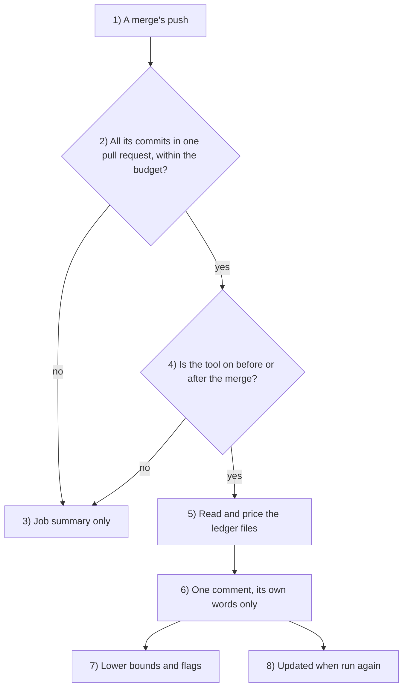

# The report comment

When a pull request merges with the tool on before its merge or after it, a workflow posts one short comment on it with what it cost.

**Status:** designed, not built yet.

**Spec:** `report-comment`

**Requirements:** R20, R94, R95, R157, R96, R65, R202, R193, R21, R97, R98, R23, R66, R67, R168, R24, R68, R69, R70, R35, R158, R102

## Expected behaviour

When a merge gets a comment, and what it says:

- 1) The report runs only for the push that a merge makes to the default branch (R68).
- 2) A push gets a comment only when all its commits belong to one pull request, and the report keeps to a call budget and a time limit (R69, R70).
- 3) Otherwise the job summary says why, and how many ledger files the push removes or changes (R60, R172).
- 4) The configuration before the merge and after it decides, so a pull request cannot turn off its own report (R19, R172).
- 5) The ledger files are read from git as data, within bounds, each by the version that it states (R23, R66, R158).
- 6) The comment says what its figure is and where it comes from, and quotes no text from the pull request or the jobs API (R20, R21, R94, R97).
- 7) It counts refused calls and calls that may leave the token cost low, and says when the ledger files flag calls left out (R95, R157).
- 8) A report run again updates only its own comment (R96).

In detail:

- **What it shows.** The total cost; the cost by model, by token type and by activity type; the CI minutes and their cost; the price table's date; the tool's version; how many ledger entries were counted, and how many were not, for each reason; how many calls capture refused; how many it read without a stop reason, with a note that the token cost is then a lower bound, and how many carried a usage field that capture does not know, with a note that the token cost may be low, counting those marks only on the entries that it counts (R20, R94, R95). It also says when the hook file at the merged commit differs from the one at the report's own commit, and when the hook's registration in that commit's `.claude/settings.json` or `.claude/settings.local.json` carries a checksum other than that commit's hook file's, so that the registration runs nothing, as when it was copied from the README of another release, quoting nothing from either file, and leaves out, without stopping, a settings file that it cannot read (R65, R202).
- **Calls left out.** When the pull request's ledger files say that calls were left out, for consent, for their age or because their repository could not be told, the comment says so for each reason, as what those files say, with no count, and says that the token cost, each of its parts and the total are then lower bounds (R157). For consent, it says that capture could not show that some calls were made while it was on, and nothing of capture being off (R157). It always says that calls that no ledger file holds are neither counted nor flagged (R157). A restored ledger file, or one that holds at least one entry, each of which the default branch already held, adds no counts and no flags (R95).
- **What it says about itself.** That the figure is an API-equivalent estimate, not a bill, and that it counts the usage that the pull request's commits carry and the CI runs on those commits (R94). Calls that Claude Code's own tools make to a model, such as a web fetch's summary, are counted only where the transcript holds them.
- **Only its own words.** The comment, the job summary and the log hold numbers, the report's fixed text, and names that the price table lists. It never quotes ledger lines, file names, branch names, job names or any other text from the pull request (R21, R97).
- **One comment.** When the report runs again, it updates its own comment and no one else's (R96).
- **Within bounds.** R23 and R67 give how the report reads ledger files from git as data, R66 what it does when they are too large to read, and R35 and R102 how it holds each line to the ledger format and completes.
- **Read by its version.** R158 gives how the report reads each ledger file that the merge adds by the version that its first line states, so that a report older than the hook says what it could not read rather than misreading it. R193 gives what the comment says when a ledger file comes from a later release of the capture step than the report's own, as a person's plugin can while the repository pins an earlier release (DR-208), and R168 how the default branch's earlier ledger files are read.
- **When there is no comment.** R69 and R70 give the pushes that get no comment, and R172 what the job summary says of a merge that finds the tool off both before it and after it.
- **A budget that runs short.** A pull request whose runs and jobs take more calls to read than the budget leaves still gets its comment, as R64 gives it.

## How it is validated

This feature is validated first by its spec's scenarios: each gets an acceptance test before its code, seen to fail for the expected reason (task 1.4). Then come the checks that DR-084 to DR-093 and DR-109 apply to all the tool's code. Beyond those, this feature has its own:

- A property test that no planted string reaches the comment, the job summary or the log (task 4.1), and unit tests at every boundary of the ledger format, with each file read by the version that its first line states (task 4.2).
- Tests that the report refuses every event but the push that a merge makes, and that the token is in none of its outputs (task 4.3).
- End to end: this repository's own merge posts a report whose figures can be recomputed from its ledger, the price table and the jobs API (task 7.1).

## Known limitations and the roadmap

The design's risks that concern this feature and are not on the roadmap, each with what it means:

- **A workflow runs a script or a local action that a pull request changes**: the comment flags changes to workflow and settings files, but not to the scripts that workflows run, which stay for review in the diff.

The [roadmap](../roadmap.md) gives what is planned next and later, and the limitations that an adopter notices.

## See also

- `report-comment` in `openspec/`, and design decisions 7 and 16 of `add-pr-cost-calculator`.
