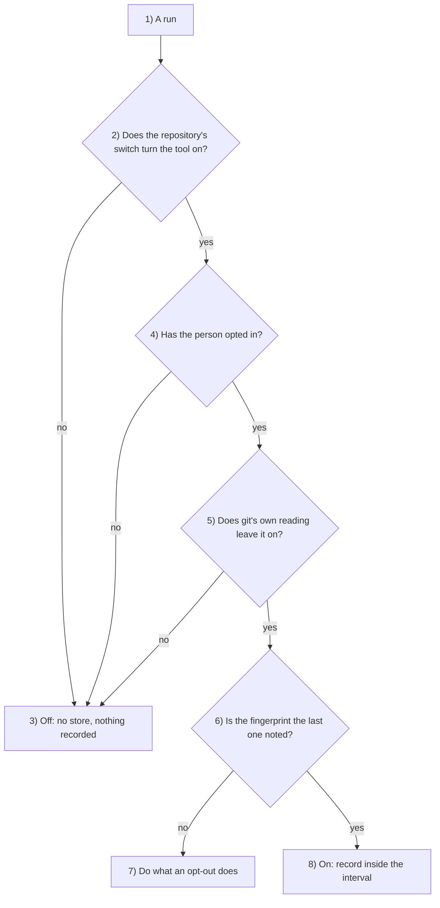

# Turning it on, and personal opt-in

Two switches decide whether anything is recorded. The repository decides whether the tool is used there, and each person's own opt-in, which they set themselves or which the cloud environment that they use or their organization sets, decides whether their own sessions' usage is published.

**Status:** designed, not built yet.

**Spec:** `switch-and-opt-in`

**Requirements:** R1, R182, R225, R36, R37, R103, R104, R105, R38, R106, R39, R160, R40, R144, R107, R145, R108, R166, R109, R161, R162, R146, R110, R19, R91, R92, R171, R172, R93, R296

## Expected behaviour

Whether a run records anything:



- 1) A run of the capture step, which reads both switches before it starts any program (R118).
- 2) The repository's switch is a valid `.pr-cost.json` in the working tree with `enabled` set to true (R19, R36, R91, R171).
- 3) A run that finds a switch off creates no store and notes no session, and still takes back and puts back ledger files (R1, R110, R145).
- 4) The person's opt-in is `pr-cost.capture`, read from their two global git configuration files alone, by git's rules, with only some of git's true values turning it on (R37, R38, R105, R106).
- 5) Git's own reading of the key in the repository can turn capture off, never on (R39, R160).
- 6) A run that finds both switches on notes its time and a fingerprint of the files that hold the opt-in (R107).
- 7) A fingerprint other than the last one noted is taken as an opt-out, which ends every session's interval and empties the store (R109, R162).
- 8) Otherwise the run records the calls made inside its session's interval, which begins and ends at a run (R40, R108, R144).

In detail:

- **The repository's switch.** A repository turns the tool on by adding a valid `.pr-cost.json` at its root with `enabled` set to true, and off by removing the file or setting `enabled` to false. R36 and R171 give when capture takes the file to be valid: a file that holds a key that its format does not document, which in this version is any key but `enabled`, is not valid and leaves the tool off, whatever `enabled` says (DR-190). R19 and R172 give the report on such a file, and what the comment and the job summary then say (DR-191, DR-192). A key that a later version adds is a breaking change, since every earlier version takes a file that holds it to be not valid, so it goes in only with or after the pull request that moves the hook file and the calling workflow's pin to that version, and so is a key that a later version no longer documents, which goes out before or with that pull request.
- **The person's opt-in.** A person turns capture on for themselves by setting `pr-cost.capture` to `true` in their global git configuration: `~/.gitconfig`, or git's file in their XDG configuration folder, and `~/.gitconfig` decides where both set it. In a cloud environment of Claude Code, the global git configuration is the session machine's own, so a person opts in there with one line in the environment's setup script, `git config --global pr-cost.capture true`, which opts in each session in that environment (DR-201). Removing that line, or using another environment, reaches only the sessions that start, or whose machines are rebuilt, afterwards: in a session that is running, `git config --global pr-cost.capture false` turns capture off until something writes the opt-in again, as the setup script does on a machine that is rebuilt and an organization's hook can at a session's start or resume, or after `/clear` or a compaction, and on an environment the variables `GIT_CONFIG_COUNT=1`, `GIT_CONFIG_KEY_0=pr-cost.capture` and `GIT_CONFIG_VALUE_0=false` do, from each of its sessions' next restore, since git's own reading of them can turn capture off, never on, unless a settings file that the session loads sets `GIT_CONFIG_COUNT` itself. `git config --show-origin --get-all pr-cost.capture` shows each value of a session's opt-in and where it comes from, and `git config --global --get pr-cost.capture` only the global file's value (R194). R37, R38, R103 and R104 give how capture reads those two files itself. So nothing in a repository can turn capture on for anyone, whether through its own git configuration, a variable that its Claude Code settings set, or a file that a configuration includes, and an outside contributor's usage is never committed because a repository's owner turned the tool on.
- **Strict values.** `pr-cost.capture` opts a person in only as `true`, `yes`, `on`, `1` or the bare key, in any case. Any other value, including ones that git itself reads as true, such as `2`, does not.
- **Built for people who opt in.** Capture does not try to stop a person who avoids it on purpose, who can turn it off at any time. A mode in which an organization turns its members' capture on and they cannot turn it off is left to a later change (DR-189).
- **The plugin opts no one in.** The plugin records nothing for a session whose opt-in is not on, however it came to that session, as when a person adds it or their organization turns it on for its members or requires it (DR-202) (R182).
- **An organization's option.** An Owner of a Team or Enterprise organization can put the opt-in's line in the setup script of a cloud environment that it shares with its members, which opts in each session that a member starts in that environment, in every repository that turns the tool on, and a member who never picked that environment when the organization makes it their default. An organization's managed settings can also run a hook that writes the opt-in, whatever environment its members use; the hook that the README gives writes it only when `CLAUDE_CODE_REMOTE` is `true`, in cloud sessions alone, since one that writes it on a member's own computer leaves it in their own git configuration after the hook goes and after they leave, and only when it is not already `true`, since a write of the person's global configuration ends every interval. A member sees what turns capture on with `git config --show-origin --get-all pr-cost.capture` and `/hooks`, and turns it off with an opt-out of their own, as above, and a person's own line belongs in an environment of their own. An organization that does this tells its members first, and what is then published, as the README asks. Claude Code's pages say that Projects are not offered on Team or Enterprise plans yet, so the option reaches members' project threads only once they are (DR-202).
- **One opt-in for every repository.** One opt-in covers every repository that turns the tool on, those that adopt it later among them, and none of them says so when it does (DR-185). With the plugin, that is each such repository where the person's sessions work or commit, whether or not it registers the hook. A person who opts in for their own work and then works in another repository that turns the tool on has their counts recorded there, in ledger files that their commits there carry.
- **Every agent, those that later releases add among them.** One opt-in records Claude Code, the one agent that the first version records, and each agent that a later release adds, with no further step. No opt-in leaves one agent out, so a person who does not want an added agent recorded turns capture off where they use it (R225, R224, DR-235).
- **Turning capture off for one clone or for a folder.** Setting `pr-cost.capture` to `false` in a repository's own git configuration turns capture off in that clone only, and setting it to `true` there opts no one in. To turn capture off for every repository in a folder, a person uses git's own conditional includes:

  ```ini
  [pr-cost]
      capture = true
  [includeIf "gitdir:~/work/"]
      path = ~/.gitconfig-no-pr-cost
  ```

  with `~/.gitconfig-no-pr-cost` holding `capture = false` under `[pr-cost]`. Git matches `gitdir:` against where the repository's `.git` folder is, so a linked worktree follows its repository, wherever the worktree itself lies: a linked worktree in `~/work/` whose repository lies elsewhere is not covered, and needs `capture = false` in its repository's own configuration. A condition that names the folder through a symbolic link holds for capture only where the `PWD` that capture is given names, through that link, the top level of the repository's main worktree, and not a folder within it, and the hook runs in whichever folder Claude is working in, so within one session such an opt-out can hold in one run and not in the next; it should name the folder's real path. Git reads an include whose file is missing as if it were not there, without a word, so where `~/.gitconfig-no-pr-cost` is missing, as on a machine that a person's synced dotfiles reach without it, capture stays on in the folder. `git config --show-origin --get-all pr-cost.capture`, run in a repository in the folder after `cd "$(pwd -P)"`, which moves to its real path, lists each value with the file that gives it, which shows whether the opt-out reaches that repository whatever `PWD` capture is given. Once capture's own reading finds both switches on, it asks git, as R160 gives it, so the opt-out holds wherever the include stands in the file, no value that git reads later undoes it, and no variable that a repository's settings set can hide it. What git reads never turns capture on, so an included file can turn capture off for a folder but cannot turn it on for one alone.
- **Consent for each call.** R40, R108 and R144 give when capture records a call, by the intervals when both switches were on. So calls made before a person opts in, or while capture was off, are never recorded later, even when the person opts in before the next run, and a call already being made when an interval begins is left out. R155 gives what the next ledger file says of them.
- **A start run.** R148 gives the run that comes when a session starts, and the interval that it begins, unless the person sends the first prompt the moment the session starts. Where no start run comes, the calls before the session's first run that finds both switches on are left out (R40), as they may be in every session whose first prompt is given before it starts, as with `claude -p`, the Agent SDK or a cloud session. So a person opts in before they start a session.
- **What a run notes.** R107 gives the time and the fingerprint that a run that finds both switches on notes in the store, and R162 that a run that finds another fingerprint does what an opt-out does, since a change that it cannot read may have been an opt-out and back, so two sessions in one clone for which git reads `pr-cost.capture` from different files, as when their environments name different configuration files, empty the store at each other's runs, and few of their calls are recorded. R166 gives what a clock set back ends. The repository's own git configuration is part of the fingerprint only when it sets the opt-in key, so a routine `git push -u`, which writes that file, ends no interval, and an opt-out and back there between two runs is not seen. A write to a global configuration file, such as `git config --global user.email` or the `safe.directory` line that git's own advice adds, does end the interval, as an opt-out does, and the calls that it leaves out are flagged for consent.
- **No store without consent.** A run that finds either switch off creates no store and adds nothing of its session to one, so a person who has never opted in leaves nothing in the git common directory. R145 and R55 give what such a run does to a store that is already there.
- **An opt-out empties the store.** R109 gives what a run that finds the person's own capture off removes from the store, and R151 when the store then removes itself. No call made before that run is staged after it, and turning capture on again records no call that answers a line written before a later run that finds both switches on. R161 gives that a run that began before an opt-out writes nothing after it. A store that a later release wrote waits for a run of a release that knows its version, which treats the opt-out as one that no run saw.
- **Take-backs go on.** Taking back and putting back ledger files does not wait on the switches, so a ledger file staged before capture was turned off is still taken back when no commit took it (R110).
- **What stays published.** An opt-out, a removed ledger file or a removed store unpublishes nothing. Each ledger file that was pushed stays in its branch's history, in every clone and fork that holds it, and in the report comments already posted. A ledger file in a commit not yet pushed is published by that commit's push, opt-out or not, and a force-push that drops a commit does not remove what GitHub keeps for the pull requests that referenced it. One case that no scenario holds, and that the threat model's T38 records as a residual: a commit approved at a permission prompt after an opt-out made while the prompt waited still takes the ledger file staged before it, since no run comes between.
- **What a hash does not hide.** Each entry names its call by a hash of the call's message id, and that does not hide whose record it is: the commit that adds the ledger file names its author, and where a cloud session commits under Claude Code's own name, the pushes and the pull request that carry it are the person's, and whoever holds the transcript can match each hash to its call.
- **The report's switch.** R19 gives which configuration the report reads, from before the merge and after it. So a pull request cannot turn off its own report, and the pull request that turns the tool on gets one.
- **Flagged changes.** A pull request's comment flags the changes that R93 lists.

## How it is validated

This feature is validated first by its spec's scenarios: each gets an acceptance test before its code, seen to fail for the expected reason (task 1.4). Then come the checks that DR-084 to DR-093 and DR-109 apply to all the tool's code. Beyond those, this feature has its own:

- Tests that try each way that a repository or its environment could opt a person in, and check that capture stays off: the repository's own git configuration, git's environment variables, an included file, and a relative configuration folder (task 2.4).
- Tests that an opt-out that only git finds turns capture off, in an included file under a condition that holds, whether the include stands before or after the line that turns capture on, in the system's configuration file or in the file that `GIT_CONFIG_GLOBAL` names, and that no value that git reads later undoes it (task 2.4).
- Tests of the intervals: that calls made before an opt-in or while capture was off are not recorded, also when no run came between, that capture turned off and on again between two runs, any other change to the files that hold the opt-in, or a clock set back ends the interval, while a write to the repository's own git configuration that does not set the opt-in key does not, that no interval begins again until the clock has passed the times that the session's runs saw, that a run of another session that finds the fingerprint changed drops the calls waiting to be staged, that a person who has not opted in leaves no store, and that an opt-out empties the store of everything but what a take-back needs (task 2.4).
- Tests that the report reads `.pr-cost.json` from before and after the merge, including a file that a pull request makes unreadable, also by adding a key that its format does not document or giving a key twice, and what the comment and the job summary then say (task 4.1).

## Known limitations and the roadmap

The design's risks that concern this feature and are not on the roadmap, each with what it means:

- **Capture is turned off and on again between two runs, and the files that hold the person's opt-in keep their device and inode numbers, size and modification times**: the step cannot see such a change, so the calls between those runs are recorded.
- **The system's clock steps back between a run that finds a switch off and a later call**: a call made while capture was off can be recorded, in narrow cases.
- **No session runs again in a repository after its person opts out or stops**: the store's notes stay until a run of a release that knows the store comes, or the person removes the store.
- **A person removes the opt-in's line from a setup script, or moves to another environment, while threads that use it still run**: threads that already run keep capture on until their machines are rebuilt, unless the person uses an opt-out that reaches them.
- **One opt-in also records each agent that a later release adds**: a person who opted in, or whose organization opted them in, has that agent's calls recorded once they use it, with no step of theirs, and keeps one agent out only by turning capture off where they use it.

The [roadmap](../roadmap.md) gives what is planned next and later, and the limitations that an adopter notices.

## See also

- `switch-and-opt-in` in `openspec/` for the full requirements and their scenarios.
- Design decisions 6 and 16 of `add-pr-cost-calculator`, DR-185 for why one opt-in covers every repository, DR-201 for the opt-in in a cloud environment's setup script, and DR-202 for who may set the opt-in.
