# How it works

This page explains the tool as a whole: what goes in, what comes out, how a cost is computed and from where, each flow, and every credential, permission and outside connection it uses. A developer who reads it should know what the tool does, and should treat anything it does that this page leaves out as a defect.

The tool is designed and not built yet, so this page describes the design in `openspec/changes/add-pr-cost-calculator/`. It changes in the same pull request as what it describes, and `tests/test_documentation.py` checks it against the workflows.

## In one paragraph

A hook in each Claude Code session, from the hook file that a repository registers or from the plugin that a person adds, reads the session's transcript and, for a person who has opted in, keeps the token counts of the model calls made from each repository that it works on while both switches were on, in a store of that person's own in that repository's git common directory, for no longer than 30 days. Just before the agent commits, it writes the waiting counts into a new ledger file and stages it, so the agent's own commit carries it. When the pull request merges, a GitHub Actions workflow reads the ledger files that the merge added, prices them from the dated price table at the tool's own commit, adds the CI minutes of the pull request's own commits from GitHub's jobs API, and posts one comment. The ledger stays in the repository as the record.

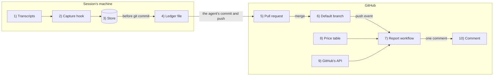

- 1) The session's and its subagents' transcripts, which Claude Code writes (R2, R75).
- 2) The capture step, run from the hook file that a repository registers or from the plugin that a person adds, keeps the counts of the calls made from the repository, for a person who has opted in, while both switches are on (R1, R3, R179).
- 3) The store, in the repository's git common directory, which keeps nothing past its retention window of 30 days (R47, R150).
- 4) Just before the agent commits, the hook writes the waiting counts into a new ledger file and stages it (R7, R8).
- 5) The pull request's branch, which the agent's own commit and push carry the ledger file to (R7).
- 6) The default branch, whose push by a merge alone starts the report (R68).
- 7) The report workflow reads the ledger files that the merge added, as git blobs (R23, R58).
- 8) The dated price table at the tool's own commit, never fetched (R14, R30).
- 9) GitHub's REST API, for the pull request, its runs and their jobs (R18, R62).
- 10) One comment on the merged pull request (R20).

## Parts

| Part | Where it runs | Reads | Writes |
|---|---|---|---|
| Capture step, one standard-library Python file | The machine running the Claude Code session | The session's and its subagents' transcripts; the hook's input from Claude Code; `.pr-cost.json` in the working tree; `pr-cost.capture` in the person's two global git configuration files, and each value of it that git reads in the repository; the device and inode numbers, size and modification times of the files that hold it; the system's clock; the repository's git state | Its store in the git common directory, which only a run that finds both switches on creates; one ledger file per commit under `.pr-cost/ledger/`, staged; nothing else |
| Plugin: a manifest, its hooks and the capture step | The machine running the Claude Code session, from the plugin's own folder, outside every working tree, in each session that loads it from the person's claude.ai account or a project's settings | As the capture step, in each repository that its run works on | As the capture step, in each repository that its run works on |
| Store | Inside the repository's git common directory (`git rev-parse --git-common-dir`), one file for each user, `pr-cost-<uid>/store.json` where the system numbers users and `pr-cost/store.json` where it does not, outside the working tree and shared by its worktrees | Written and read by the hook only, as its owner, its folder and file readable and writable by that owner alone, except on Windows | Never committed; it keeps nothing past its retention window of 30 days, and is removed once it holds nothing |
| Ledger files | `.pr-cost/ledger/<YYYY-MM>/<random>.jsonl`, committed with the agent's work | A first line that states the ledger format's version, the release of the capture step that wrote it, the count of refused calls and three flags for calls left out, then counts per call, never content | Written once, never changed by the tool |
| Configuration | `.pr-cost.json` at the repository root | `enabled`, as `true` or `false`, `repository`, the `owner/name` of the repository that it turns the tool on in, which a file that enables the tool must hold, and `commit_before_push`, as `true` or `false`, which turns the step's commit before a push off where it is `false` (R320), and no other key, since a file that holds a key that its format does not document, gives a key twice, has no `enabled` of `true` or `false`, or enables the tool without a `repository` in GitHub's form is not valid and leaves the tool off (R296) | Changed only by a pull request |
| Price table | `prices/models.json` and `prices/github-actions.json`, at the tool's commit | Dated rates, modifiers and the source of each | A new row per price change, by pull request |
| Report, a reusable workflow and its Python code | A GitHub Actions runner, on the push a merge makes to the default branch | The push event; as git blobs: the ledger files and `.pr-cost.json` before and after the merge, the ledger files of the default branch's first-parent history before it, the hook file at the merged commit and at its own commit, and `.claude/settings.json` and `.claude/settings.local.json` at the merged commit; the price table; GitHub's API | One comment on the merged pull request; its job summary |
| Release workflow | A GitHub Actions runner, on a pushed tag `vMAJOR.MINOR.PATCH` | `pyproject.toml`, the plugin's manifest, `CHANGELOG.md`, the root marketplace file, the guide, `docs/patterns.md`, the threat model, `docs/threat-model.md`, at the tag and at the default branch's tip (R251), the tag's commit, and the README's checksum of the plugin's zip | A GitHub release with a CycloneDX bill of materials and the plugin's zip, created as a draft and published only once both are attached and checked |
| Marketplace | `.claude-plugin/marketplace.json` on this repository's default branch, and the folder of the plugin that it lists | The tool's plugin alone, from a folder that holds it as a published release's tag builds it | Changed only by a pull request after a release that changes nothing else, which CI holds to that release's plugin |

## Inputs and outputs

**Inputs:**

- Claude Code's transcript lines, one JSON object per line: each assistant message's model, `usage` block (input, output, cache-write by lifetime, cache-read tokens), service tier, speed, inference region, server-side tool requests, the tools it called, the working directory, and the provider where the lines name it; and each line's time, its kind and the line that it names as its parent, which place a call inside or outside an interval.
- Claude Code's hook input: the hook event, the session's id, the transcript's path, `cwd`, and for Bash commands the command's text and `tool_use_id`.
- `.pr-cost.json`; the person's opt-in, `pr-cost.capture`, from their two global configuration files, which the person writes, or the setup script of the cloud environment that they use, and each value of it that git reads in the repository, with the file that each comes from; and the device and inode numbers, size and modification times of the files that hold it.
- The system's clock, read in UTC.
- The price table at the tool's own commit.
- GitHub: the push event, the pull request that a commit belongs to, the workflow runs and job attempts on the pull request's own commits, and the report's own earlier comment.

**Outputs:**

- Ledger files: a first line that states the ledger format's version, the release of the capture step that wrote it, the count of refused calls and three flags for calls left out, for consent, for their age or because their repository could not be told, with no count; then one entry per call: UTC day in `utc_day`, agent in `agent`, provider in `provider`, model, a SHA-256 hash of the message id in a field whose name ends in `_id`, main agent or subagent, the token counts, the price attributes, the activity type, and marks for a call read without a stop reason or with a usage field that capture does not know (R2, R4, R6, R42, R43, R155, R156, R290).
- One comment per merged pull request, a brief summary followed by a collapsed section of the detail that ends with a JSON block of its figures for programs, and the report's job summary (R283, R285).
- A GitHub release per version tag, with its bill of materials and the plugin's zip.

## What comes in and what goes out

Everything that crosses the tool's boundary, in three tables, each row with how what it names is pinned, or that it is not, and the decision records that decide it (R280). Nothing comes in from a repository or tool outside this one but what a record names (DR-285). The tables describe what crosses; they say nothing of what may steer an agent's work here, which `CLAUDE.md` alone gives (DR-258).

### What the tool takes in when it runs

| What | What crosses | How it is pinned | Records |
|---|---|---|---|
| Claude Code's transcripts | Each call's model, token counts, attributes, working directory and, where its lines name it, provider, read while the session runs | Not pinned: Claude Code writes them, and capture reads them tolerantly, counting what it cannot read | DR-003, DR-007, DR-032, DR-033, DR-044, DR-057, DR-128, DR-135, DR-172, DR-178, DR-199, DR-302, DR-309 |
| Claude Code's hook input | The event, the session's id, the transcript's path and the directory | Not pinned: Claude Code gives it | DR-044, DR-172 |
| The switch and the opt-in | `.pr-cost.json`, and `pr-cost.capture` in the person's git configuration | The repository's own file and the person's own setting, read strictly | DR-169, DR-021, DR-183 |
| The price table | Dated rates and modifiers in one currency, by provider and model, with a default provider for a model listed under more than one and a model with no price among them, each row added a few days after its price changes, and the day the table was last checked | Pinned with the tool's own commit | DR-020, DR-298, DR-299, DR-300, DR-306 |
| GitHub | The push event, the pull request, its runs and job attempts, and the report's earlier comment | Not pinned: GitHub's API, read within a call budget and a time limit | DR-006, DR-008, DR-019, DR-038, DR-039, DR-051, DR-060, DR-061, DR-160, DR-217 |
| Ledger files of a pull request | Token counts, written by whoever can push to its branch | Not pinned: read as untrusted data, in every earlier format | DR-040, DR-044, DR-066 |
| Python | The standard library of the person's or the runner's Python | Not pinned: Python 3.11 or any later release | DR-023 |

### What this repository takes in to be built and checked

| What | What crosses | How it is pinned | Records |
|---|---|---|---|
| Superpowers | The vendored skills that guide how code is built | A commit and its tag in `vendor/superpowers/UPSTREAM.lock`, compared with upstream in CI | DR-041, DR-275, DR-284 |
| OpenSpec | Its command line program and its generated skills | An exact version in `package-lock.json`, its skills regenerated and compared in CI | DR-042, DR-196 |
| GitHub actions | `actions/checkout`, `actions/setup-python` and `actions/setup-node`, which the workflows run | A full commit that its repository tagged | DR-068 |
| Development tools | pytest, ruff, mypy and the other tools in `requirements-dev.txt` | Exact versions; their own dependencies are not pinned until task 1.8 adds hashes | DR-126 |
| Updates | Renovate's pull requests, and the alerts that find vulnerabilities | Renovate's preset `config:best-practices` is not pinned | DR-028, DR-111, DR-145, DR-265, DR-267, DR-287 |
| CI's runner and Python | The image that every job runs on, the oldest supported Python and the newest release | Not pinned: `ubuntu-latest`, and `3.x`; the oldest, `3.11` in CI's matrix and in `.python-version`, is pinned to its minor version, and its patch releases float | DR-285, DR-026 |
| Node | The runtime that runs OpenSpec's command line program in CI | Not pinned below its major version: `24` in `.node-version` | DR-285 |
| Claude Code's review commands | `/simplify`, `/security-review`, `/code-review` and `/verify` | Not pinned: the version of Claude Code that runs them | DR-093, DR-262 |
| Contributions | Pull requests, issues and comments from anyone | Not pinned: reviewed from `main`, their workflows held for approval, and merged only after the contributor licence agreement | DR-077, DR-078, DR-081, DR-244, DR-264 |
| Text that agents read | Records, the roadmap, the backlog and other repositories' context files that a session loads | Not pinned: read as data, never as instructions | DR-227, DR-258, DR-266 |
| Anything else from elsewhere | Code, tests, checks or text | Only by a record of its own | DR-285 |

### What goes out to adopters

| What | What crosses | How it is pinned | Records |
|---|---|---|---|
| The hook file | The capture step that adopters copy and register | The commit that a release names | DR-022, DR-025, DR-027, DR-030, DR-031, DR-065, DR-125, DR-134, DR-156, DR-211, DR-314 |
| The plugin | The capture step, its manifest and its hooks | A release's zip, checked against its README; or this repository as a marketplace, which Claude Code clones from the default branch, whose plugin folder CI holds to a release's build | DR-197, DR-203, DR-204, DR-205, DR-288, DR-314 |
| The report | A reusable workflow that adopters call | The commit that a release names | DR-005, DR-016, DR-018, DR-063, DR-132, DR-133, DR-139, DR-186, DR-191, DR-216 |
| Ledger files | Token counts per call, committed with the agent's work in the adopter's repository | Written once by the release that names itself in them | DR-015, DR-037, DR-045, DR-052, DR-053, DR-054, DR-127, DR-136, DR-138, DR-181, DR-200, DR-208, DR-301, DR-302, DR-313, DR-316 |
| The switch and the opt-in | What adopters and people set to turn the tool and capture on | Their form, read strictly by each release | DR-021, DR-049, DR-050, DR-183, DR-185, DR-190, DR-192, DR-201, DR-202, DR-235, DR-307 |
| The store | Notes on the person's machine, in the git common directory | Its format's version, which a later release upgrades | DR-171, DR-173 |
| The comment | The pull request's figure and what it is made of, with a block of its figures for programs | The report's commit and the price table at it | DR-002, DR-004, DR-110, DR-124, DR-155, DR-294, DR-295, DR-296, DR-297, DR-303, DR-318 |
| Releases | A tag, the release, its bill of materials and its changelog entry | Immutable, from a tag on the default branch | DR-074, DR-096, DR-097, DR-098, DR-122, DR-123, DR-148, DR-149, DR-154, DR-167, DR-209, DR-311, DR-317, DR-319 |
| The repository and its pages | The README, the documentation, the licence and every tracked file | The default branch, and the commit that a release names | DR-069, DR-070, DR-116, DR-117, DR-118, DR-157, DR-182, DR-212, DR-213, DR-215, DR-220, DR-229, DR-241, DR-242, DR-243, DR-279, DR-282, DR-286 |
| What this version leaves out | The uses that later changes take up | Not pinned: each by a record that a later one replaces | DR-189, DR-222, DR-223, DR-234 |

## How a cost is computed

For each ledger entry counted, on the entry's UTC day *d*:

```
token cost = input * rate(provider, model, input, d)
           + output * rate(provider, model, output, d)
           + cache write 5 min * rate(provider, model, cache write 5 min, d)
           + cache write 1 h * rate(provider, model, cache write 1 h, d)
           + cache read * rate(provider, model, cache read, d)
           + server-side tool requests * rate(provider, model, request type, d)
```

`rate` is the latest row in `prices/models.json` for the entry's provider and model dated on or before *d*, or, for a provider recorded as `unknown`, for its model's only or default provider, which the comment's detail says was taken from the table (R289), with every modifier that the table lists for the entry's attributes, combined as the table states (R14, R16). Where the transcript gave no cache lifetime, the cost is a range between the two lifetimes' rates (R15). An entry whose provider and model no row names, whose model, attribute or day has no price, or whose model the table lists without a price, is counted in tokens and left out of the cost, and the comment names it (R14, R17, R61, R287, R289). Every rate is in the table's one currency, `USD`, which the runner table states too (R288), and is read as an exact decimal (R284).

For each attempt of each job of each counted run, each attempt rounded up on its own (R18):

```
CI cost = ceil(duration in seconds / 60) * rate(runner type, day the job ran)
```

The runs counted are those on the pull request's own commits that no push to the default branch started and that were created before the merge (R62, R120). A job on a runner that `prices/github-actions.json` does not list is counted in minutes and left out of the cost (R63).

```
total = sum(token cost) + sum(CI cost)
```

The comment splits the token cost by model and provider, by token type and by activity type. Every figure can be recomputed from the ledger, the price table at the report's own commit and the jobs API; the comment gives the day the table was last checked, and says when a priced call came after it (R294). Each figure is computed exactly and rounded only where it is written, so a total can differ from the sum of its shown parts (R284).

## Flows

The overview of every flow is the diagram in the section [In one paragraph](#in-one-paragraph). Each flow below draws one part of it in detail.

### Capture during a session

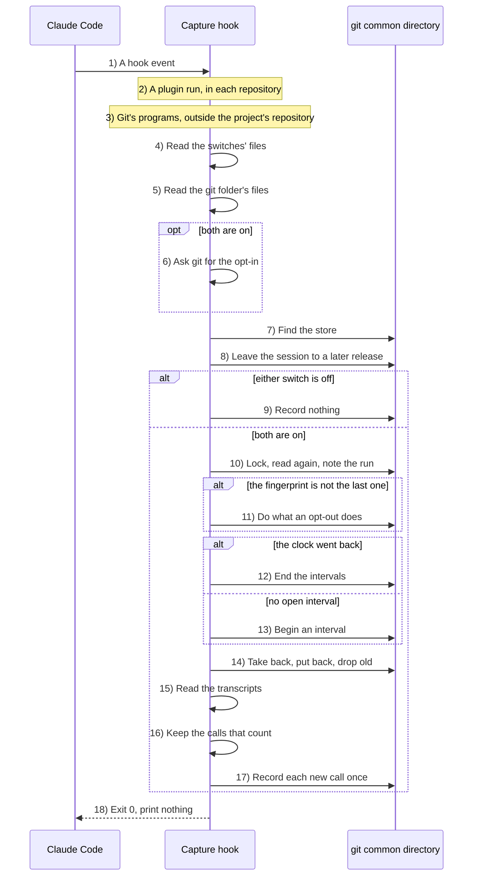

- 1) Claude Code runs the hook at `SessionStart`, `Stop`, `SubagentStop`, `StopFailure` or `SessionEnd`, with the session's id, the transcript's path and `cwd` (R2, R148).
- 2) A run of the plugin does what follows in each repository that it works on, as the next flow shows (R180).
- 3) Outside the repository that holds the project directory, a run of the plugin starts a git command that can start a program that the repository's configuration names only before or after a git command of its session there, or to take back a file that its own session staged there (R197).
- 4) It reads `.pr-cost.json` and the person's two global configuration files before it starts any program (R37, R91, R118).
- 5) It reads the project directory's `.git`, the `commondir` file of the git folder that it names and each worktree's `gitdir` file before it starts any program, and stops, saying so, when one cannot be read, a worktree has no `gitdir` file, or this is a linked worktree whose git common directory is not named `.git` (R54).
- 6) When both are on, it asks git twice, in the session's environment and without its `GIT_` variables, for each value of `pr-cost.capture` that git reads here, and takes capture to be off when either answer does not come within the time budget, or when its last value, or the last value of any file but the two global ones, is not true (R160).
- 7) It finds the store, and stops, leaving it as it was, when this release does not know its version (R55).
- 8) Unless the person's capture is off, it stops when the store notes that a later release has run in this session, leaving the session to that release's copy (R191).
- 9) With either switch off, it creates no store, removes one that does not parse, and in one that parses ends this session's interval, noting this run's time, empties it if the person's capture is off, takes back or puts back what is due, drops what is older than the retention window, removes it if it then holds nothing, and records nothing (R109, R110, R145, R150, R151).
- 10) With both on, under the store's lock, it reads both switches again, then notes the run's time and the fingerprint of the files that hold the opt-in (R107).
- 11) When the fingerprint is not the last one that the store notes, of whichever session, it does what an opt-out does (R162).
- 12) When the clock reads earlier than the latest time that this session's runs noted or read, it ends the session's intervals and begins none (R166).
- 13) When the session has no open interval, it begins a new one here (R108).
- 14) It takes back or puts back what is due, and drops what is older than the retention window (R110, R150).
- 15) Unless this is a start run, it reads the transcripts again from the earliest line that a call not yet recorded may answer, up to the time budget, and at a line whose time is later than the clock, ends the session's intervals (R148, R165, R90).
- 16) It keeps the calls that are over, whose working directory is in this repository, and whose answered line falls inside an interval (R3, R42, R144, R147).
- 17) It records each new call once, by the hash of its message id, with hashes of its session, worktree and branch, and notes a flag for calls left out (R41, R149, R155).
- 18) It exits with success and prints nothing (R13).

### Which repositories a run works on

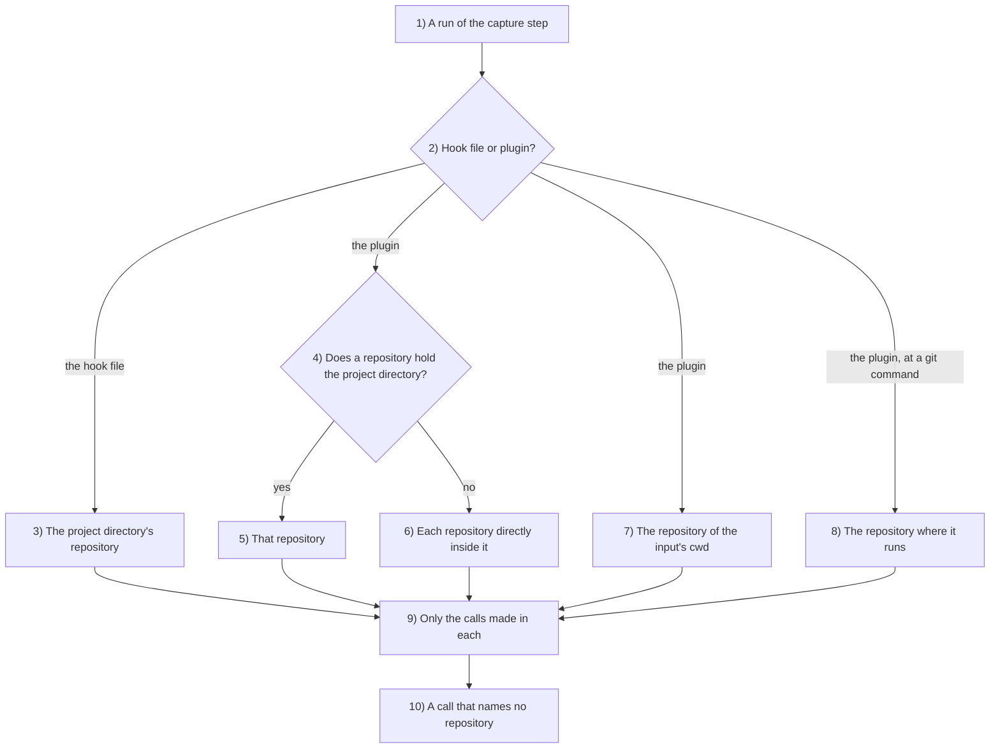

- 1) A run of the capture step, from either way of running it (R76, R180).
- 2) Whether the hook file's registration or the plugin started the run (R179).
- 3) A run from the hook file's registration works on the repository that holds the project directory alone (R76).
- 4) A run of the plugin first asks whether a repository holds the project directory (R180).
- 5) If one does, it works on that repository (R180).
- 6) If none does, it works on each repository whose top level is directly inside the project directory, and none deeper (R180).
- 7) It also works on the repository that holds the hook input's `cwd` (R180).
- 8) Before or after a git command, it works on the repository where that command runs (R180).
- 9) In each repository, it records only the calls whose line gives a working directory in it (R3, R147).
- 10) A call whose directory holds the repository's folder and names no repository is left out, and flagged in the session's next ledger file there (R155).

### How the plugin reaches a session

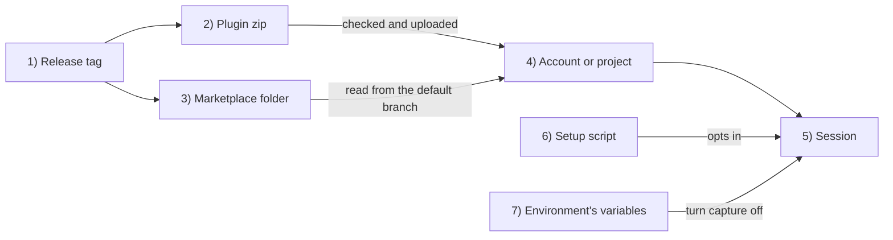

- 1) A release's tag, which builds the plugin (R183).
- 2) The plugin's zip, whose SHA-256 the README at the tag's commit gives (R183, R187).
- 3) A pull request after the release moves the marketplace's folder to the release, and CI holds the folder to the tag's build (R184, R190).
- 4) The person's claude.ai account or project: the person checks the zip's checksum and uploads it, or claude.ai reads the marketplace from the default branch when the person checks for updates or turns on syncing, and the update needs nothing accepted (R187).
- 5) A project's cloud thread, or a terminal session signed in with the account (R185).
- 6) The environment's setup script, `git config --global pr-cost.capture true`, opts in each session in that environment; having the plugin alone opts no one in (R182, R185).
- 7) The environment's variables `GIT_CONFIG_COUNT`, `GIT_CONFIG_KEY_0` and `GIT_CONFIG_VALUE_0`, setting `pr-cost.capture` to `false`, turn capture off in each session from its next restore (R160, R194).

### A commit

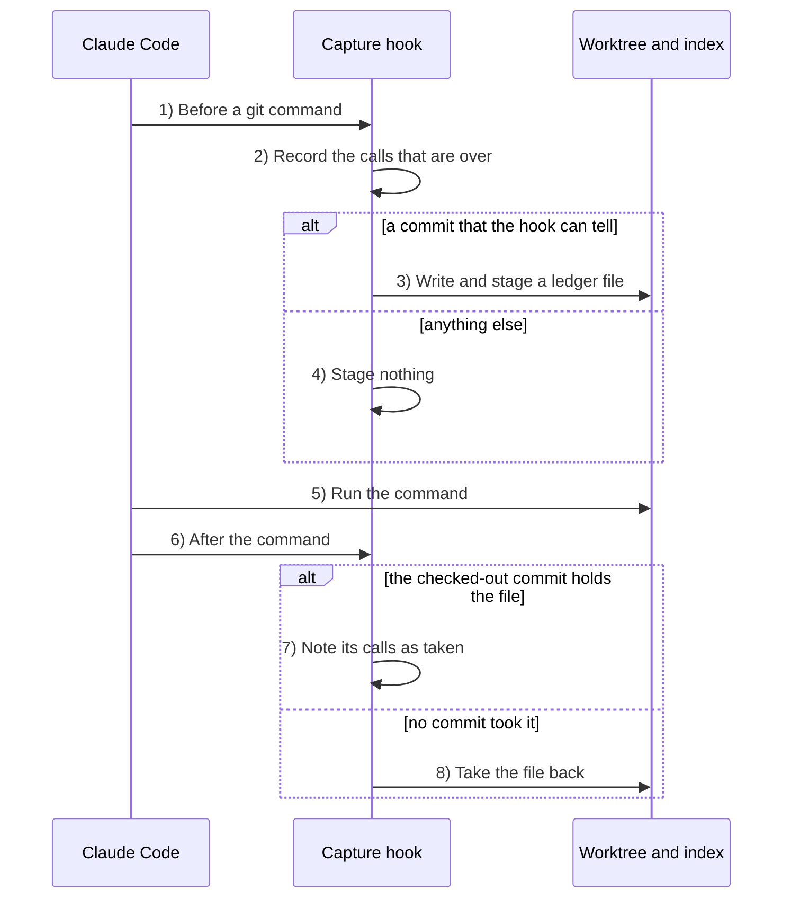

- 1) Claude Code runs the hook at `PreToolUse` for a Bash command matching `Bash(git *)` (R7).
- 2) The hook records the calls that are over, as in capture (R7, R42).
- 3) For a git commit whose branch and contents the hook can tell, it writes `.pr-cost/ledger/YYYY-MM/<random>.jsonl`, with the flags due for that worktree and branch, and stages it alone (R8, R56, R78, R81).
- 4) For anything else it stages nothing, and the calls wait (R8, R82).
- 5) Claude Code runs the command (R7).
- 6) Claude Code runs the hook again at `PostToolUse` or `PostToolUseFailure` (R9).
- 7) When the checked-out commit holds the file, the hook notes its calls as taken (R52).
- 8) When no commit took it, the hook takes the file back, and its calls and flags wait for a later commit (R9, R113).

### A commit that never ran

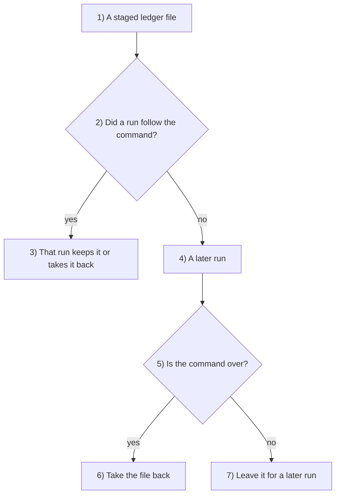

- 1) A ledger file staged for a command (R8).
- 2) Whether a run after the command followed it (R87).
- 3) If one did, that run keeps the file or takes it back (R9).
- 4) If none did, because the command was refused, blocked, cancelled or interrupted, any later run in the repository looks at it (R87).
- 5) The command is over once its result, a later call, its agent's stop or its session's end is seen, or once its note is older than the retention window (R87).
- 6) If it is over, the run takes the file back, unless a commit holds it (R87, R113).
- 7) If not, the run leaves it for a later run (R87).

### Calls that wait when the agent pushes

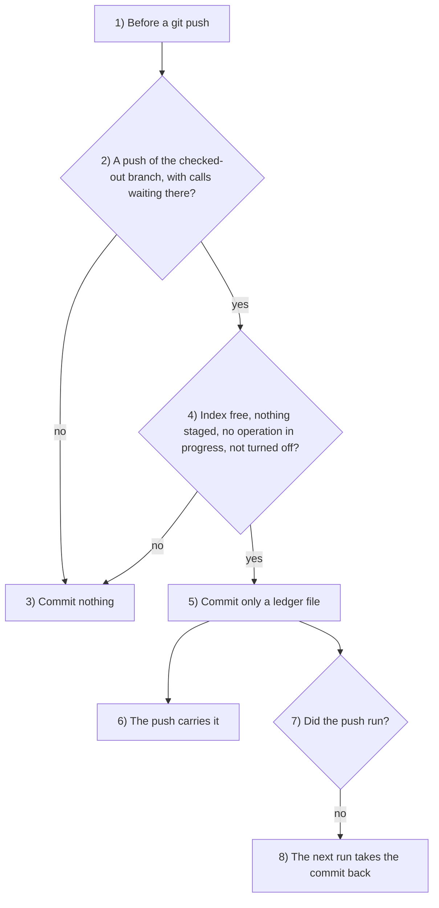

- 1) The hook runs before a Bash command whose only git command is a top-level `git push` in the foreground (R305, R311).
- 2) Only a push that sends the checked-out branch to a branch of its own name, with calls recorded on that branch that no commit carries, gets the step's commit (R305, R311).
- 3) Any other push, or one that the next answer stops, gets no commit, and its calls wait (R305).
- 4) The index must be free and hold nothing staged, no rebase, merge, cherry-pick or bisect may be in progress, and the configuration file must not turn the commit off (R305, R320).
- 5) The step writes the calls into a ledger file and commits only that file, running no hook and no program that git's configuration names but the person's own signer, guessing no identity, and signing with the person's global or system signer where git asks for signatures (R312, R320).
- 6) The push sends that commit with the agent's own (R305).
- 7) Whether the push ran (R313).
- 8) Where it did not and the branch's tip is still that commit, the next run takes the commit back, leaving HEAD, the index and the working tree as they were where it cannot (R313).

### A merge and its report

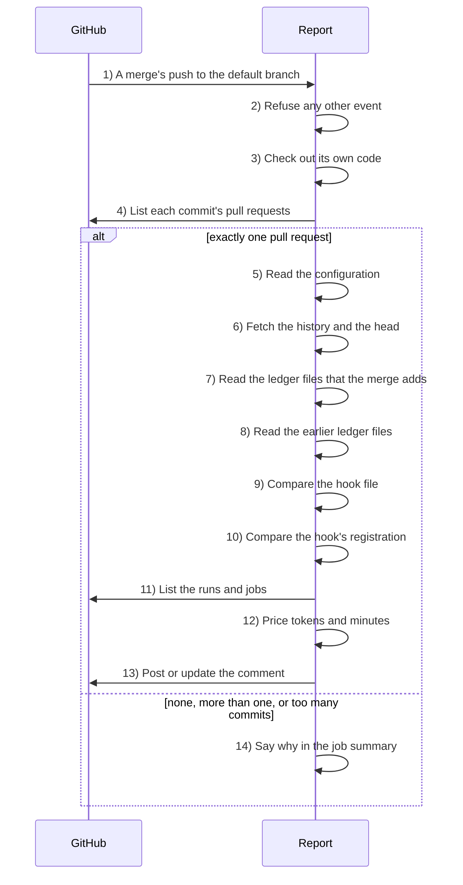

- 1) GitHub starts the report on the push that a merge makes to the default branch (R68).
- 2) The report refuses any other event (R68).
- 3) It checks out the tool's own code at `job.workflow_sha`, without keeping the token (R24).
- 4) It lists the pull requests associated with each commit that the push adds (R69).
- 5) It reads `.pr-cost.json` before and after the merge, and when both leave the tool off, or name another repository, says why in the job summary and stops (R19, R172, R296).
- 6) It fetches the default branch's history and the pull request's head, `refs/pull/<number>/head` (R23).
- 7) It reads the ledger files that the merge adds, as git blobs, within the size bound, holding each file to the version of the ledger format that its first line states (R23, R35, R58, R66, R158).
- 8) It reads the call ids of the first-parent history's earlier ledger files, by the versions that they state, so that no call counts twice (R59, R67, R168).
- 9) It compares the hook file at the merged commit with the one at its own commit (R65, R93).
- 10) It compares the hook's registration in the merged commit's settings files, read as git blobs within a size bound of their own, with that commit's hook file, leaving out a file that it cannot read (R202).
- 11) It lists the runs and every job attempt on the pull request's own commits (R62, R121).
- 12) It prices tokens and minutes from the price table, and notes which reasons the ledger files flag calls left out for (R14, R18, R157).
- 13) It posts the comment, or updates its own earlier one (R20, R96).
- 14) When the commits belong to no pull request or to more than one, or there are more commits than the call budget allows, it says why, and how many earlier ledger files the push removed or changed, in the job summary, and posts no comment (R60, R69, R70).

### A price update

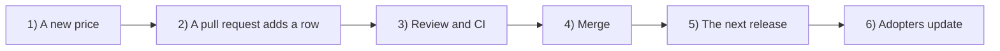

- 1) Anthropic, another provider or GitHub publishes a new price (R14, R289).
- 2) A few days later, a pull request adds a row with its provider, its effective date, the day it is added and its source, dated after the newest row of its provider, model and price and at most 30 days before the day it is added, unless it names its reason, and updates the day the table was last checked (R14, R294, R295, DR-299).
- 3) Review and CI check it, since prices are read from the table at the tool's own commit and never fetched (R30).
- 4) It merges to the default branch (R30).
- 5) The next release names the commit in its text (R27).
- 6) Adopters update the hook and the workflow pin together, to the commit that the release names (R203).

### A release

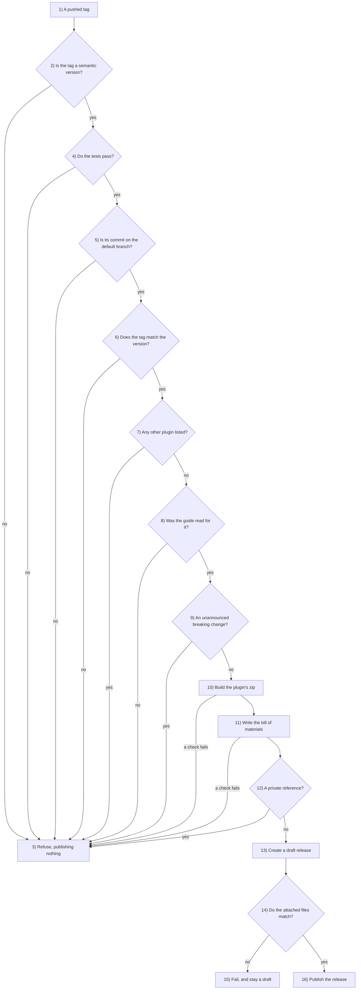

- 1) The owner pushes a tag `vMAJOR.MINOR.PATCH` (R27).
- 2) The release workflow checks the tag's form, `v` and a semantic version, before any other step (R27, R71).
- 3) Any check that fails refuses the release, and nothing is published (R27, R72).
- 4) The tests run at the tagged commit on the oldest and newest Python, with every expected failure run as an ordinary test, so that every acceptance test passes (R25, R139, DR-167).
- 5) Its commit must be in the default branch's first-parent history (R27).
- 6) The tag must match `pyproject.toml`, the plugin's manifest and `CHANGELOG.md` (R27).
- 7) The root marketplace file must list no plugin but the tool's (R190).
- 8) The guide must say that its entries were last read for this version, and the changelog entry must name the backlog item of each gap that it gives under Security, Privacy, Identity and credentials, or Supply chain and releases (R230).
- 9) A changed surface manifest, or a listed breaking change, needs a raised major number and a Breaking section (R122, R123).
- 10) The plugin's zip is built from the tagged tree, and the release is refused when its SHA-256 differs from the README's, its manifest holds another key, a hook is not a command, or its capture step differs from the hook file (R183, R188).
- 11) The CycloneDX bill of materials is written from the tagged tree, and the release is refused when that fails, misses an action, or a checksum differs (R28, R72).
- 12) The bill and the release text are checked for private references (R72).
- 13) The release is created as a draft, naming the commit, with the changelog entry, and the bill of materials and the plugin's zip are attached (R189).
- 14) Each attached file is downloaded again and must have the size and SHA-256 of the file built (R189).
- 15) If one does not, the run fails, naming the file, and the release stays a draft with nothing published (R189).
- 16) Otherwise the release is published (R189).

## Credentials and permissions

**On the session's machine:** none. The hook uses no token, no key and no account, and the plugin runs the same file with the same rights, from its own folder. It reads the person's two global git configuration files for `pr-cost.capture`, and asks git for each value of it that git reads in the repository, which can only turn capture off (R37, R160). It writes only its store inside the git common directory, a file of its own, in a folder of its own, that its owner alone can read and write, except on Windows, and the ledger file it stages, and touches the index only to stage, take back or put back that one file, which a run of the plugin does outside the repository that holds the project directory only before or after a git command of its session there, or to take back a file that its own session staged there (R47, R152, R56, R197).

**The report's workflow**, as an adopter calls it, uses the workflow's own `GITHUB_TOKEN` and no other secret (R24). Its caller grants it exactly:

- `contents: read`, to read the ledger files, `.pr-cost.json` and the pull request's commits from git;
- `actions: read`, to list the workflow runs and job attempts on those commits;
- `pull-requests: write`, to post and update its one comment.

It needs no `contents: write`, so a ruleset protecting the default branch needs no exception for it.

**The release workflow**, in this repository only, holds `contents: write` in its release job alone, to create the release as a draft, attach the bill of materials and the plugin's zip, read them back and then publish the release, and runs only for a pushed tag (R189).

**This repository's CI** (`.github/workflows/ci.yml`) grants every job `contents: read` and nothing else. Its checkouts keep no credentials, and no job reads a secret. Each job that runs the tests clones the whole history rather than one commit, so that the decision records' check can compare the records with what the default branch held before the change. The workflow names that commit in `BASE_COMMIT`: the pull request's base commit, or the commit that a push to the default branch replaced. The check also compares with where HEAD left the default branch, since a pull request's base is the branch that its author chose, and a pull request's run starts again when its base changes, and so when its title or description is edited, since GitHub reports these as one event. The repository is public, so the whole history gives those jobs nothing that they could not already read. Every command that a step of this workflow or of the next runs, but one step of the job `ci` that checks the filter from outside it, prints through `scripts/printable_log.py`, the shell that their defaults give, so that what those commands print reaches the log as printable ASCII (R278). The lines that the runner itself writes before each step's command, such as the step's script and its environment, and what an action prints, such as the checkout's, do not go through the filter.

**The base commit's checks** (`.github/workflows/base-checks.yml`), in this repository only, run on every pull request to `main` from the default branch's own copy of the workflow, on `pull_request_target`, so that a pull request cannot change the check that judges it, and grant their one job `contents: read` alone. The job checks out the base's commit, keeps no credentials, reads no secret and restores no cache; it fetches the merge commit that GitHub tests anonymously, over HTTPS, reads that commit's tree from git's objects alone, runs nothing from it, and gets the pull request's number and head only through the step's environment, with GitHub's workflow commands off while it runs; a path that Windows or macOS would write into a checked path fails it (R299, R317, R321, R323, DR-312, DR-321). Its check is the second one that the ruleset on `main` requires, beside `ci` (DR-320, DR-322). GitHub blocks `pull_request_target` in public repositories from 2 December 2026 unless the owner's Actions policy allows it, so the owner allows it for this one workflow file.

**The daily check of Renovate's proposals** (`.github/workflows/renovate-watch.yml`), in this repository only, runs every day and by hand, and grants its one job `contents: read`, to check out the pins, and `pull-requests: read` and `issues: read`, to list Renovate's pull requests and find its dependency dashboard. It holds no write permission and reads no secret: its one credential is the workflow's own token, which it sends to GitHub's API alone (R263, DR-267).

Each job of each workflow in this repository, with the permissions it is granted. `tests/test_documentation.py` fails when a job is granted anything this table does not give it, or the table gives a job something it is not granted:

| Workflow | Job | Permissions |
|---|---|---|
| `ci.yml` | `python` | `contents: read` |
| `ci.yml` | `openspec` | `contents: read` |
| `ci.yml` | `vendor` | `contents: read` |
| `ci.yml` | `windows-line-endings` | `contents: read` |
| `ci.yml` | `ci` | `contents: read` |
| `base-checks.yml` | `base-checks` | `contents: read` |
| `renovate-watch.yml` | `check` | `contents: read`, `pull-requests: read`, `issues: read` |

## Connections to the outside world

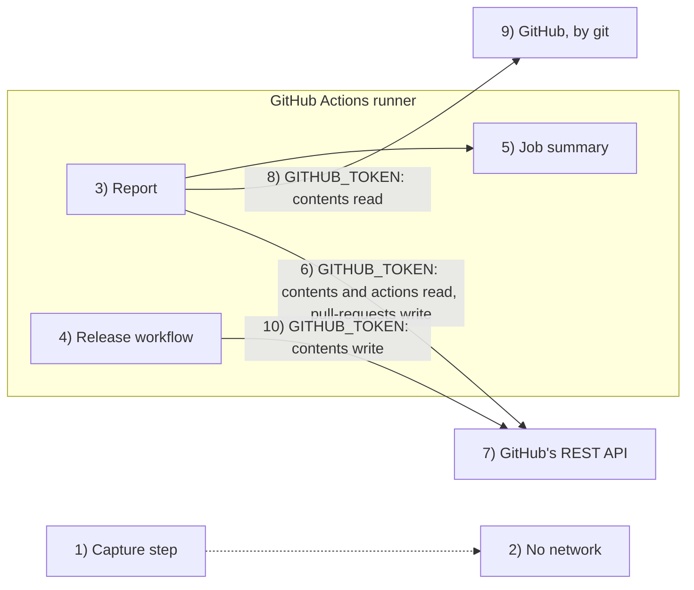

- 1) The capture step, on the session's machine (R12).
- 2) It opens no network connection, so it uses no token, no key and no account (R30).
- 3) The report, which an adopter's workflow calls (R24).
- 4) The release workflow, in this repository only (R189).
- 5) The report's job summary, where it says why it posted no comment (R60, R172). The tool has no directory of users and no logging service of its own.
- 6) The report authenticates with the workflow's own `GITHUB_TOKEN`, which its caller grants `contents: read`, `actions: read` and `pull-requests: write`, and no other secret (R24).
- 7) GitHub's REST API, at the host in `GITHUB_API_URL`, over HTTPS: the report finds the merged pull request, lists its runs and jobs and posts or updates its comment, and the release workflow creates, checks and publishes a release (R30, R189).
- 8) The same token, read only, fetches by git (R24, R30).
- 9) GitHub by git, over HTTPS: the tool's own code at its commit, and the adopter's default branch's history and the pull request's head (R23, R30).
- 10) The release workflow's release job alone holds `contents: write`, and runs only for a pushed tag (R189).

| From | To | Protocol | Why | Credential |
|---|---|---|---|---|
| Capture step | Nothing | None | The hook opens no network connection (R30). | None |
| Report | GitHub's REST API, at the host in `GITHUB_API_URL` (`api.github.com` on github.com) | HTTPS | Find the merged pull request, list its runs and jobs, post or update its comment (R30) | `GITHUB_TOKEN` |
| Report | GitHub, by git, through `actions/checkout` and `git fetch` | HTTPS | Fetch the tool's own code at its commit, and the adopter's repository to read as data: the default branch's history up to the push's commit and the pull request's head as `refs/pull/<number>/head` (R30) | `GITHUB_TOKEN` |
| Release workflow | GitHub's REST API | HTTPS | Create the release as a draft, upload the bill of materials and the plugin's zip, download each to check it, and publish the release (R189) | `GITHUB_TOKEN` |

Prices are never fetched: the price table is a file at the tool's commit, changed only by a pull request (R30). The plugin opens no connection either: claude.ai reads it from a release's zip that the person uploads, or from this repository's marketplace on its default branch, with the person's own account, when they check for updates or turn on syncing.

**Developing this repository** also connects to these, none of which ships to adopters:

| From | To | Protocol | Why |
|---|---|---|---|
| CI and cloud sessions | `actions/checkout`, `actions/setup-python` and `actions/setup-node` from GitHub, each pinned to a full commit | HTTPS | Check out the code and install Python and Node on the runner |
| CI and cloud sessions | The Python Package Index | HTTPS | Install the pinned development tools in `requirements-dev.txt` |
| CI and cloud sessions | The npm registry | HTTPS | Install the pinned OpenSpec CLI from `package-lock.json` |
| CI | `github.com/obra/superpowers` | HTTPS, git | Check that `vendor/superpowers/` matches the commit that `UPSTREAM.lock` pins |
| The base commit's checks | This repository on GitHub, by git, with no credential | HTTPS, git | Fetch the merge commit that GitHub tests for a pull request, as `refs/pull/<number>/merge`, to read its tree as data (R299, R317) |
| The base commit's checks | `github.com/obra/superpowers` | HTTPS, git | Check that the pull request's `vendor/superpowers/` matches the commit that its own `UPSTREAM.lock` pins, from GitHub whatever `SYNC_REMOTE_BASE` says (R317) |
| The daily check of Renovate's proposals | The Python Package Index's JSON API and the npm registry | HTTPS | Read when each release of a pinned tool was published (R263) |
| The daily check of Renovate's proposals | GitHub's REST API, at the host in `GITHUB_API_URL` | HTTPS | List Renovate's pull requests, the head commits of its open ones and its dependency dashboard, with the workflow's own token (R263) |

## Environment variables

As designed, the hook reads `CLAUDE_PROJECT_DIR`, `HOME`, `XDG_CONFIG_HOME` and `PATH`, and on Windows `HOMEDRIVE`, `HOMEPATH` and `USERPROFILE`, and the plugin's command names the step's file through `CLAUDE_PLUGIN_ROOT`, the folder that Claude Code loaded the plugin from. It sets `GIT_NO_LAZY_FETCH=1` and `GIT_TERMINAL_PROMPT=0` for every git command it runs, so that git fetches nothing and asks for no credentials (R111). Its own reading of the opt-in ignores the variables that point git at other configuration files or add settings (R37). Every git command that it starts runs without `PWD`, so that git matches a condition on a repository's folder against its real path, and without the session's variables whose names begin with `GIT_`, but those that it sets itself, so that they choose neither the repository, its index nor the files that git reads its settings from, save for one of the two git commands that ask for each value of the opt-in key, which runs in the session's own environment, its `PWD` included, where those variables and `PWD` can only turn capture off, and which the hook stops at its time budget, taking capture to be off, when a file that they name holds it up (R169, R160). The hook reads each run's time from the system's clock in UTC, which no variable sets. The report reads `GITHUB_API_URL`, `GITHUB_TOKEN` and the event that GitHub passes the workflow. Task 5.3 checks this list against the code once it exists.

## What it never does

- Put a prompt, a response, code, a file's contents, a tool's name, input or output, a path, a working directory, a branch name, a user name, a session identifier, a transcript's path, a `tool_use_id` or a time of day, or a hash of any of them, in a ledger file or in anything it publishes. For its own use, the person's store in the git common directory of their clone keeps, for no longer than 30 days, the window that DR-175 sets, the worktree and branch that each waiting call goes to, a session's id, a transcript's path, a `tool_use_id` and the fingerprint of the files that hold the opt-in, each as a hash, and, only until a run resolves a staged or taken-back ledger file, that file's path and its worktree's name, and for a staged one its transcript's path, which carries the session's id, and nothing in the store leaves that directory (R4, R47, R149, R150, R170).
- Record the usage of anyone whose opt-in is not on, as they set it themselves, or as the cloud environment that they use or their organization's managed settings set it for them, or a call that it cannot show was made while both switches were on. The plugin, however it came to a session, opts no one in. A run that finds a switch off creates no store and adds nothing of its session to one, so someone who has never opted in leaves nothing in the git common directory, and an opt-out empties the store of everything but what a take-back or a put-back still needs, at a run of a release that knows the store's version (R1, R40, R109, R145, R182).
- Keep a copy of a transcript, or of any line of one, in any file (R154).
- Look for repositories below a session's project directory deeper than directly inside it: a run of the plugin meets a repository only through the project directory, Claude's current directory or a git command run there (R180).
- Start a git command that can start a program that a repository's own configuration names, such as `core.fsmonitor` or `gpg.program`, in a repository that a run of the plugin only meets or moves into, outside the one that holds the project directory: it starts one there only before or after a git command of the session there, or to take back a file that the session staged there (R197).
- Unpublish what was pushed. An opt-out, a removed ledger file or a removed store leaves each pushed ledger file in its branch's history, in every clone and fork that holds it, and in the comments already posted (R146).
- Send anything from the session's machine anywhere. The ledger leaves the machine only in the person's own commits, when they push (R30, R111).
- Run, import or install anything from the pull request it reports on (R24).
- Write to the repository, beyond the ledger file staged for the agent's own commit (R22, R56).
- Fetch prices, or contact any service other than GitHub (R30).
